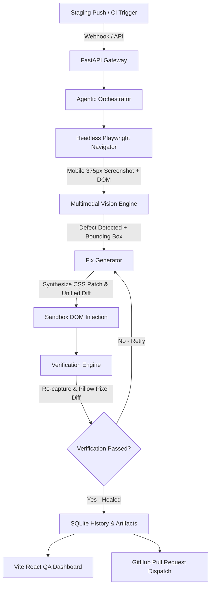

# 👁️ OmniSight: Multimodal UI Self-Healing & Autonomous RPA Agent

> **Next-Generation Autonomous Visual QA**: Bridging the gap between DOM selectors and human visual perception. OmniSight navigates web applications with headless Playwright, detects visual layout defects via Vision-Language Models (VLMs), synthesizes localized CSS patches, verifies repairs in a closed-loop sandbox, and dispatches automated GitHub Pull Requests with visual proof.

---

## 🌟 Technical Highlights

- **Headless Navigator**: Python Playwright engine supporting multi-viewport responsive audits (Mobile 375×812, Tablet 768×1024, Desktop 1440×900) and DOM spatial bounding-box extraction.
- **Hybrid Multimodal Vision Engine**:
  - **Cloud VLMs**: Native support for OpenAI (`gpt-4o` / `gpt-4o-mini`) and Google Gemini (`gemini-1.5-flash`).
  - **Autonomous Spatial Engine**: Built-in spatial & DOM reasoning engine requiring **zero external API keys** out of the box.
  - **Token Cropping**: Pillow-based bounding-box cropping that isolates anomalous components, saving up to 80% VLM tokens.
- **Agentic Orchestrator**: Closed-loop **Plan → Browse → Vision Audit → Defect Detection → Synthesize Patch → Execute Fix → Verification → Visual Diff** workflow with retry capabilities.
- **Automated Verification Loop**: Re-injects candidate patches, captures after-state screenshots, computes Pillow pixel discrepancy heatmaps, and verifies zero viewport blowout.
- **GitHub Pull Request Gateway**: Generates Git unified diffs (`artifacts/patches/*.diff`) and dispatches pull requests via PyGithub / GitHub API with attached visual proof.
- **Cyberpunk Dark QA Dashboard**: Vite + React frontend featuring an interactive before/after split slider, side-by-side mode, discrepancy heatmaps, real-time agent timelines, and 1-click PR approval.

---

## 🏗️ Architecture



---

## 🔑 What is an AI API Key?

An **API Key** is a secure authentication passcode generated by an AI cloud provider (like OpenAI or Google). It allows your software to send data (like a screenshot) to powerful cloud Vision Models and receive structured analysis back.

### Do you need one right now?
**No!** OmniSight features an **Autonomous Spatial Vision Engine** built directly into the system. You can run full audits, detect anomalies, heal defects, and test the entire dashboard out of the box without any API key.

### How to add an API Key whenever you are ready:
1. **OpenAI**: Get a key from [platform.openai.com/api-keys](https://platform.openai.com/api-keys).
2. **Google Gemini**: Get a free key from [aistudio.google.com](https://aistudio.google.com).
3. Open [.env](file:///k:/omnisight/.env) and paste your key:
   ```env
   OPENAI_API_KEY=sk-...
   # or
   GEMINI_API_KEY=AIza...
   ```
4. OmniSight will automatically detect the key and upgrade to Cloud VLM inference seamlessly.

---

## 🚀 Quickstart Guide (Zero to Running)

### 1. Prerequisites Check
Make sure you have installed:
- Python 3.10+
- Node.js 18+
- Git

### 2. Backend Setup
From the repository root (`K:\omnisight`):
```powershell
# Activate the existing virtual environment
.\.venv\Scripts\Activate.ps1

# Run the FastAPI backend server
python -m uvicorn backend.main:app --host 127.0.0.1 --port 8000 --reload
```
- API Documentation: [http://127.0.0.1:8000/docs](http://127.0.0.1:8000/docs)
- Test Checkout Staging Store: [http://127.0.0.1:8000/test-app/index.html](http://127.0.0.1:8000/test-app/index.html)

### 3. Frontend QA Dashboard Setup
In a new terminal window:
```powershell
cd frontend
npm run dev
```
- Open Dashboard: [http://127.0.0.1:5173](http://127.0.0.1:5173)

---

## 🧪 Hands-On Demo Steps for Mid-Project Review

1. Open the **OmniSight QA Dashboard** at `http://127.0.0.1:5173`.
2. Notice the **Reset Staging Bug** button in the header. Clicking this ensures the deliberate mobile layout anomaly (`width: 520px` button clipping on a 375px screen) is active in the test app.
3. Select the **Mobile (375x812)** viewport tab and click **Run Autonomous Audit**.
4. Watch the **Agentic Orchestrator Timeline** progress through all 9 live steps in real-time.
5. In the **Visual Diff Inspector**:
   - Drag the **Split Slider** to wipe between the overflowing button and the repaired responsive button.
   - Click **Side by Side** to view both viewports at once.
   - Click **Heatmap** to see the Pillow-generated pixel discrepancy mask.
6. Inspect the **Unified Git Diff** section to see the exact green/red syntax patch.
7. Click **Approve & Open PR** to open the Pull Request dispatch modal with attached visual proof.

---

## 📂 Project Structure

```text
omnisight/
├── backend/
│   ├── main.py                  # FastAPI server, CORS, and static routing
│   ├── config.py                # Viewport profiles and path resolution
│   ├── routes/
│   │   ├── audit.py             # Audit triggers, history, and PR approval APIs
│   │   └── webhook.py           # CI/CD webhook receiver (GitHub Actions/Jenkins)
│   ├── browser/
│   │   ├── navigator.py         # Playwright multi-viewport headless automation
│   │   └── dom_extractor.py     # DOM spatial bounds and computed styles
│   ├── agents/
│   │   ├── vision_analyzer.py   # Hybrid VLM engine (OpenAI, Gemini, Built-in)
│   │   ├── fix_generator.py     # CSS patch & unified git diff synthesizer
│   │   ├── verification.py      # Spatial assertions & Pillow pixel diffing
│   │   └── orchestrator.py      # Autonomous Plan -> Execute -> Evaluate loop
│   ├── github_integration/
│   │   └── pr_manager.py        # Branch creation and PR dispatch
│   └── storage/
│       └── db.py                # SQLite audit history and patch repository
├── frontend/                    # Vite + React Cyber Dark QA Dashboard
│   ├── src/
│   │   ├── App.jsx              # Main Dashboard logic and state
│   │   ├── index.css            # Dark theme, glassmorphism, responsive styles
│   │   └── components/          # Inspector, Timeline, Diff, and PR components
│   └── package.json
├── test-app/                    # Staging E-Commerce Checkout Store
│   ├── index.html
│   ├── checkout.css             # Configurable responsive stylesheet
│   └── checkout.js
├── artifacts/
│   ├── screenshots/             # Before, after, diff, and cropped images
│   └── patches/                 # Git unified diff (.diff) files
├── .github/workflows/ci.yml     # CI/CD automated pipeline
├── .env.example
├── .gitignore
└── README.md
```

---

## 🛡️ License
Built for Infotact Advanced Generative AI Engineering Portfolio.
